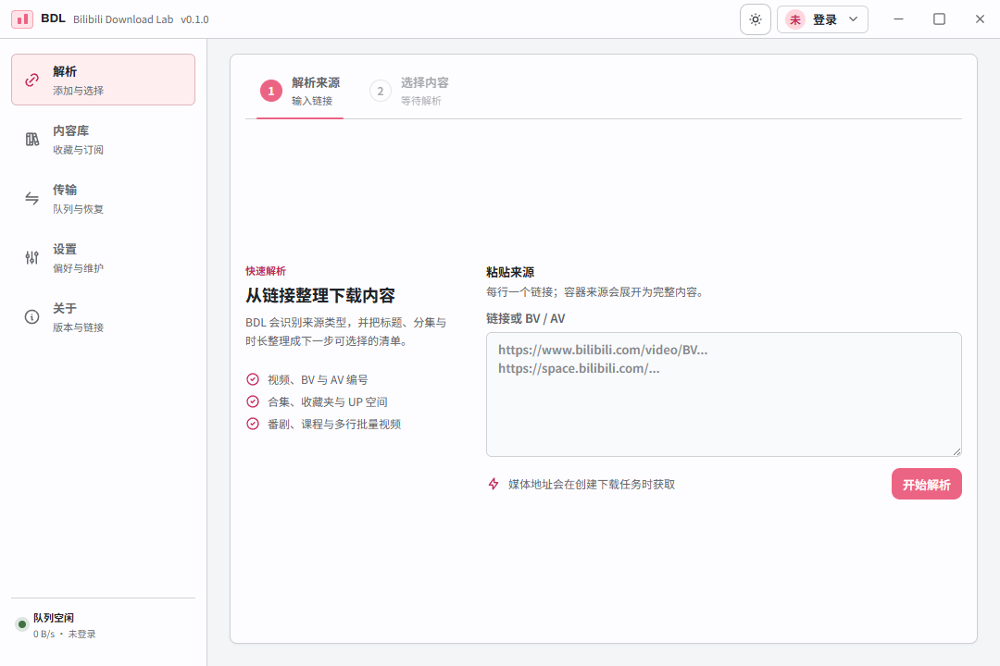
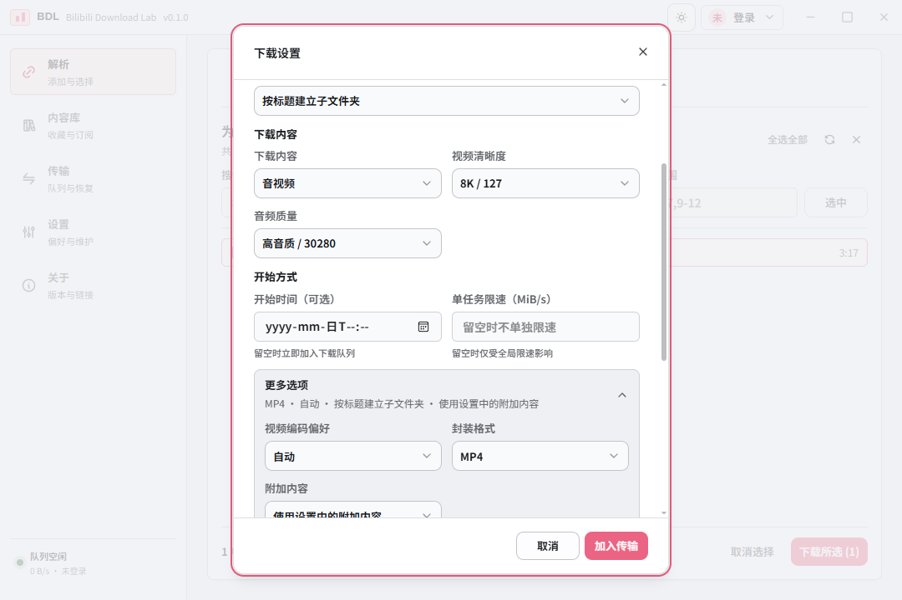
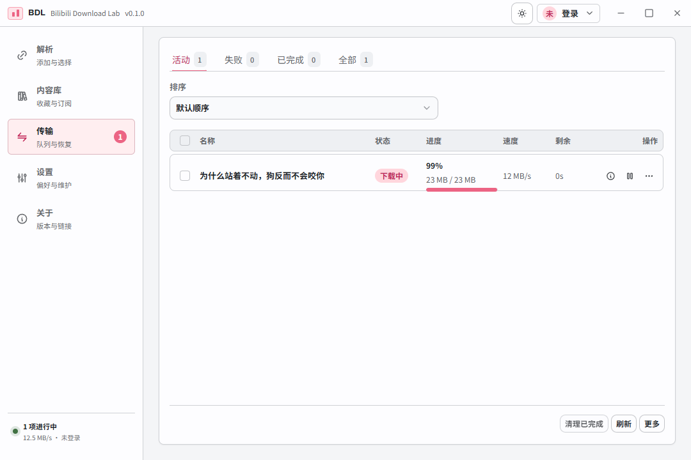
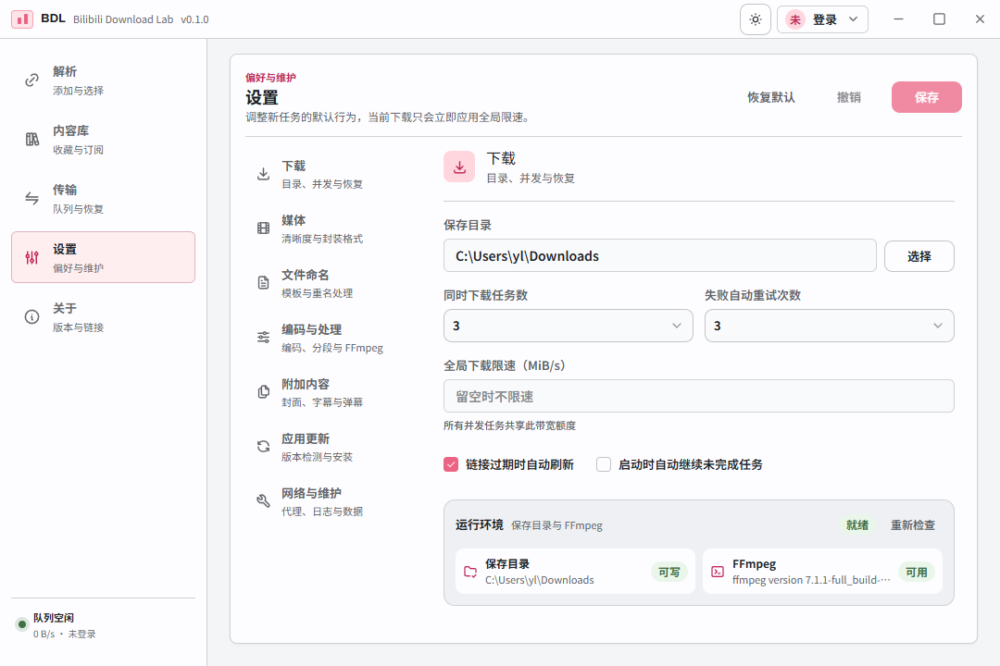

# BDL · Bilibili Download Lab

 

BDL 是一款本地优先的哔哩哔哩下载工具，支持桌面端和 Android 手机、平板。

## 能做什么

- 解析普通视频、多 P、UP 主投稿、收藏夹、合集、番剧，以及已购且未加密的课程。
- 搜索、筛选和批量选择内容，再统一创建下载任务。
- 暂停、继续、断点续传和失败重试；下载完成后可合并音视频，并保存字幕、封面和弹幕。
- 弹幕可保存为原始 XML、离线 HTML、SRT 字幕或 ASS 滚动弹幕；在下载预设的“转换”页选择格式，也可额外保留 XML。SRT 按普通字幕显示，ASS 特效需要播放器支持，高级/脚本弹幕不转换。
- 使用快速下载、下载全部资源、封装 MKV（视频+字幕）预设，或自定义仅字幕、仅音频等内容与输出组合。
- 登录后在内容库中浏览自己的收藏夹和订阅合集。设置与任务数据保存在本机。
- Android 根据窗口适配手机、平板、横屏和分屏，提供侧栏布局、紧凑列表与限宽操作弹窗。

## 下载

从 [月离软件站](https://apps.yuelili.com/software/bdl) 或 [GitHub Releases](https://github.com/Yuelioi/bdl/releases/latest) 选择对应系统的安装包：

| 系统 | 选择的文件 |
| --- | --- |
| Windows 10/11 x64 | `*-setup.exe` |
| macOS 13+ | Apple Silicon 选 `aarch64.dmg`；Intel 选 `x64.dmg` |
| Linux x86_64（预览） | `.AppImage` 或 `.deb` |
| Android ARM64（开发预览） | `.apk` |

文件名包含 `bdl-cli` 的压缩包是独立命令行工具，双击不会打开图形界面。需要命令行时请看 [CLI 使用指南](docs/CLI.md)。

桌面端需要 FFmpeg 来合并音视频或转为 MP3；安装后可在“设置 → 下载与保存”中指定 FFmpeg 路径。Android 版已内置 FFmpeg。

macOS 安装包使用 ad-hoc 签名，未经 Apple Developer ID 签名与公证；首次打开请按下方“故障处理”中的单应用操作指引执行。

## 如何使用

1. 在“解析”页粘贴视频链接或 BV/AV 号。
2. 选择内容，在下载弹窗选择预设并创建任务。预设在“设置 → 预设管理”中管理，画质与编码在对应设置分区调整。
3. 在“传输”页查看进度，或暂停、继续和重试。

登录后还可以从“内容库”选择自己的收藏夹和订阅合集。

新增或编辑下载预设时，先勾选下载内容，再在“转换 / 封装”页调整独立保存、格式转换、媒体合并和嵌入。仅字幕等组合无需下载音视频，画质设置独立于预设；旧下载配置会保留为“历史配置”。Android 暂不支持嵌入字幕或封面，请保存为独立文件。

媒体库归档可开启 NFO，配置标题、简介、标签、排序和作品集；详见 [NFO 媒体资料与模板](docs/NFO.md)。

## 界面截图

| 解析与选择 | 下载选项 |
| --- | --- |
|  |  |

| 下载队列 | 设置 |
| --- | --- |
|  |  |

## 故障处理

- **双击后没有图形窗口：**确认下载的是对应系统的安装包，而不是 `bdl-cli` 压缩包。
- **提示缺少 FFmpeg：**安装 FFmpeg 后，在 BDL 设置中选择其可执行文件。
- **macOS 提示无法验证开发者：**在“应用程序”中按住 Control 点击 BDL，选择“打开”；仍被拦截时到“系统设置 → 隐私与安全性”选择“仍要打开”。
- **仍然打不开或下载失败：**到 [Issues](https://github.com/Yuelioi/bdl/issues) 提供系统版本、安装包文件名、复现步骤和错误画面。提交日志前请移除 Cookie 和私人下载地址。

开发与贡献请看 [开发指南](docs/DEVELOPMENT.md) 和 [贡献指南](CONTRIBUTING.md)；安全问题请按 [安全报告说明](SECURITY.md) 私下提交。

BDL 与哔哩哔哩无隶属或合作关系。请仅下载你有权保存的内容。[MIT License](LICENSE)
