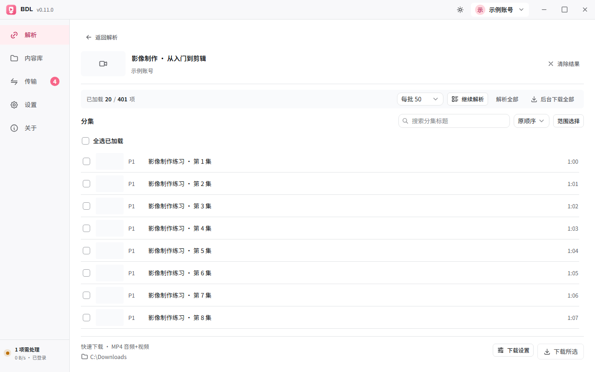
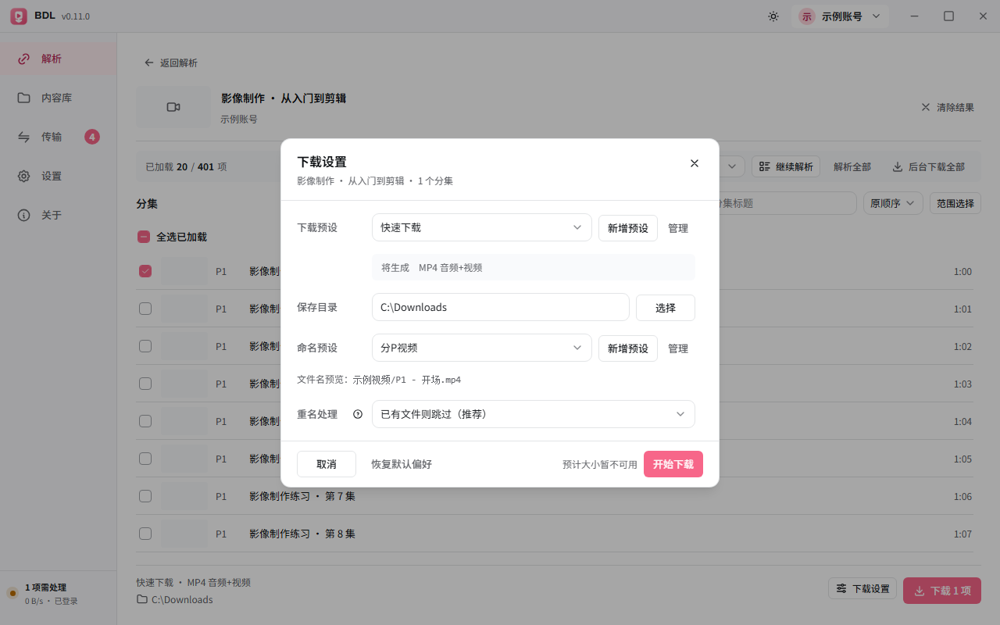
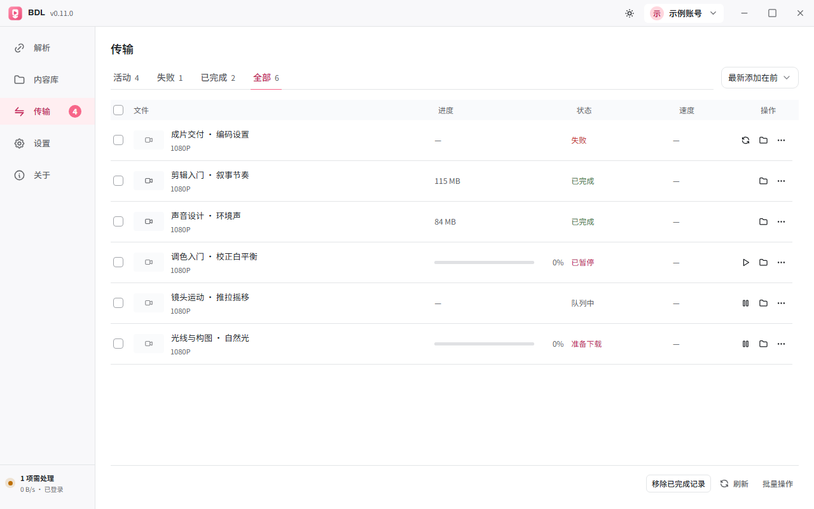
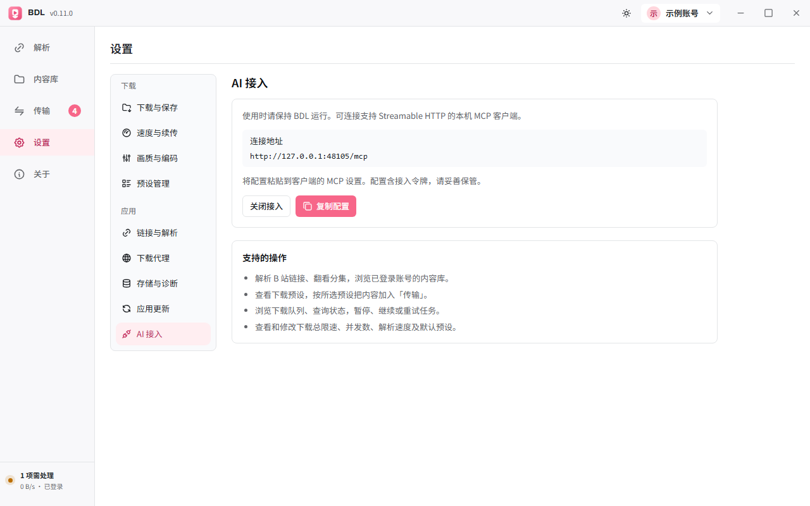

# BDL · Bilibili Download Lab

 

BDL 是一款本地优先的哔哩哔哩下载工具。粘贴链接，选好分集和预设，就可以把视频、音频及附件保存到本机。支持 Windows、macOS、Linux 和 Android。

[下载安装](#下载) · [快速上手](#快速上手) · [桌面 AI 接入](#桌面-ai-接入) · [命令行指南](docs/CLI.md)

## 下载

从 [月离软件站](https://apps.yuelili.com/software/bdl) 或 [GitHub Releases](https://github.com/Yuelioi/bdl/releases/latest) 选择对应系统的安装包：

| 系统 | 选择的文件 |
| --- | --- |
| Windows 10/11 x64 | `*-setup.exe` |
| macOS 13+ | Apple Silicon 选 `aarch64.dmg`；Intel 选 `x64.dmg` |
| Linux x86_64（预览） | `.AppImage` 或 `.deb` |
| Android ARM64（开发预览） | `.apk` |

图形版请选择表中的安装包。`bdl-cli` 压缩包供脚本和终端使用，详见 [CLI 使用指南](docs/CLI.md)。

桌面端需要 FFmpeg 来合并音视频或转为 MP3；安装后可在“设置 → 下载与保存”中指定 FFmpeg 路径。Android 版已内置 FFmpeg。

Android 版适配手机、平板、横屏和分屏。

macOS 安装包使用 ad-hoc 签名，未经 Apple Developer ID 签名与公证；首次打开请按下方“故障处理”中的单应用操作指引执行。

## 快速上手

1. 在「解析」粘贴 B 站链接或 BV/AV 号。支持视频、多 P、UP 主投稿、收藏夹、合集、番剧，以及已购且未加密的课程。
2. 在结果页搜索、筛选和选集。合集较长时可以继续解析，或按需下载全部。
3. 选择下载预设，在「传输」查看进度、暂停、续传或重试。登录后，也可以从「内容库」浏览收藏夹和订阅合集。

### 选择要保存的内容

- **视频与音频**可合并封装成 MP4 或 MKV，也可独立保存音轨或转成 MP3。在预设的「转换」中可选择嵌入封面。
- **封面、字幕和弹幕**可独立保存。弹幕支持原始 XML、离线 HTML、SRT 字幕和 ASS 滚动弹幕。高级或脚本弹幕可保留 XML。
- **媒体库归档**支持生成 NFO，可配置标题、简介、标签、排序和作品集。[NFO 媒体资料与模板](docs/NFO.md)

在「设置 → 预设管理」可组合下载内容和输出格式，在「画质与编码」可调整清晰度和编码优先级。在「速度与续传」可设置并发数、任务启动间隔和下载总限速。

## 桌面 AI 接入

自 v0.11.0 起，桌面版内置 MCP。在「设置 → AI 接入」开启并复制连接配置，把它添加到支持 Streamable HTTP 的 MCP 客户端。使用期间保持 BDL 运行。

- **解析与选集**可翻看后续分集，也可浏览 BDL 已登录账号的收藏夹。
- **下载与队列**可按预设入队、筛选任务、查询状态和成品路径，并暂停、继续或重试。AI 和图形界面共用「传输」队列。
- **设置**可查看和修改下载总限速、并发数、解析速度和默认预设。

接入仅监听本机，配置含令牌。客户端配置和参数详见 [AI 接入指南](docs/MCP.md)。

## 界面截图

| 解析与选择 | 下载选项 |
| --- | --- |
|  |  |

| 下载队列 | AI 接入 |
| --- | --- |
|  |  |

## 故障处理

- **双击后没有图形窗口：**确认下载的是对应系统的安装包，而不是 `bdl-cli` 压缩包。
- **提示缺少 FFmpeg：**安装 FFmpeg 后，在 BDL 设置中选择其可执行文件。
- **macOS 提示无法验证开发者：**在“应用程序”中按住 Control 点击 BDL，选择“打开”；仍被拦截时到“系统设置 → 隐私与安全性”选择“仍要打开”。
- **仍然打不开或下载失败：**到 [Issues](https://github.com/Yuelioi/bdl/issues) 提供系统版本、安装包文件名、复现步骤和错误画面。提交日志前请移除 Cookie 和私人下载地址。

开发与贡献请看 [开发指南](docs/DEVELOPMENT.md) 和 [贡献指南](CONTRIBUTING.md)；安全问题请按 [安全报告说明](SECURITY.md) 私下提交。

BDL 与哔哩哔哩无隶属或合作关系。请仅下载你有权保存的内容。[MIT License](LICENSE)
